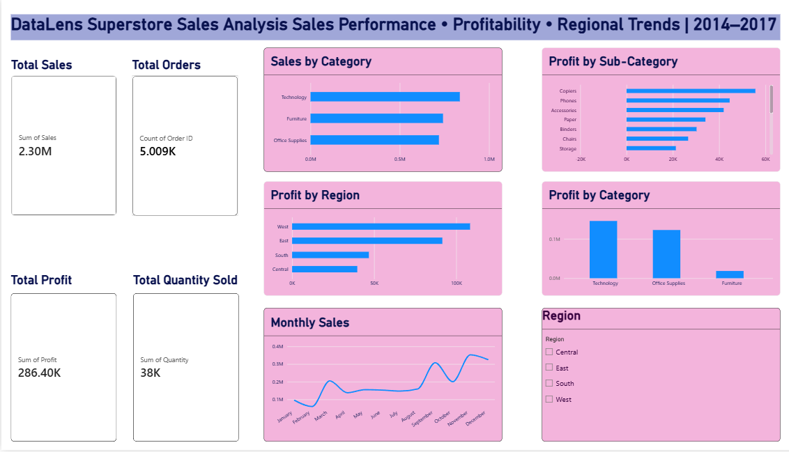

# DataLens — Superstore Sales Analysis

## Project Overview
DataLens is a data analytics portfolio project that explores retail sales, profitability, customer orders, and business performance using the Sample Superstore dataset.

The goal is to transform raw sales data into meaningful business insights through data cleaning, SQL analysis, and interactive visualizations.

## Tools and Technologies
- **Python:** Pandas for data inspection, validation, cleaning, and analysis
- **SQL:** SQLite for querying and aggregating business data
- **Power BI:** Interactive dashboard and data visualization
- **Excel:** PivotTables and PivotCharts

## Dataset
The dataset contains 9,994 records and 21 columns, including order dates, customer details, product categories, sales, quantity, discounts, and profit.

## Key Performance Indicators
| Metric | Result |
|---|---:|
| Total Sales | $2,297,200.86 |
| Total Profit | $286,397.02 |
| Units Sold | 37,873 |
| Unique Orders | 5,009 |
| Overall Profit Margin | 12.47% |

## Dashboard Preview

## Key Findings
- Technology generated the highest category profit.
- Furniture had a comparatively low profit margin despite substantial sales.
- Tables was the most loss-making product sub-category.
- Higher discount levels were associated with lower profit margins.
- The West region generated the highest total sales and profit.
- Annual sales increased from 2014 to 2017.

## Project Structure

DataLens-Superstore-Analysis/
│
├── data/
│   └── processed/
│       ├── data_quality_report.csv
│       ├── superstore_cleaned.csv
│       ├── superstore.db
│       └── pbsales.pbix
│
├── excel/
│   └── DataLens_Superstore_Analysis.xlsx
│
├── notebooks/
│   ├── sql/
│   │   └── business_analysis.sql
│   └── 01_data_inspection.ipynb
│
├── powerbi/
│   └── DataLens_Superstore_Dashboard.pbix
│
├── reports/
│   ├── business_insights.md
│   └── datalens_dashboard.png
│
├── Sample - Superstore.csv
├── .gitignore
└── README.md

## Deliverables
- Cleaned CSV dataset
- Data quality report
- Python analysis and visualizations
- SQLite database and SQL business queries
- Interactive Power BI dashboard
- Excel PivotTable and PivotChart summaries
- Business insights report

## Conclusion
This project demonstrates an end-to-end beginner data analytics workflow, from inspecting and validating data to querying it with SQL and presenting findings through Power BI and Excel.

*Note: File and folder names may vary slightly depending on the final project structure.*